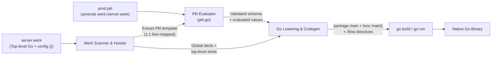

# 001 — Overview & Architecture

## Vision

Werklang is a **Go + Pkl scripting and configuration hybrid** (in the spirit of Cython, Xonsh, or Python's top-level script model), rather than a standalone from-scratch language.

A `.werk` file combines:
1. **Python-style top-level Go scripting:** No `package main` boilerplate and no `func main()` wrapper. Declarations (`func`, `type`, `const`, `var`, and top-level `:=` bindings) live in global script scope, while all top-level executable statements run top-to-bottom as the synthesized `main()` entrypoint.
2. **Embedded [Apple Pkl](https://pkl-lang.org/) configuration (`config {}`):** At most one top-level `config [name] { ... }` block defines a typed (or dynamic) Pkl template directly alongside the script code that consumes it.

At compile time, `werk`:
1. Extracts the `config` template from the `.werk` file.
2. Evaluates either an external amending `.pkl` file (if provided or discovered by convention) or the `config` template's own defaults via Pkl.
3. Strips the `config` block, hoists declarations to Go package scope, wraps top-level executable statements into `func main()`, and generates strongly-typed Go struct definitions and a compile-time populated config value.
4. Hands the pure Go output to the standard `go` toolchain (`go build`, `go run`, `go test`).

Because Pkl evaluation and validation happen during preprocessing, the compiled Go binary has **zero runtime dependency on Pkl** and pays zero startup cost for configuration parsing or constraint checking.

---

## End-to-End Example

### 1. Write a `.werk` script (`server.werk`)

```go
#!/usr/bin/env werk
import "fmt"

config app {
    /// Host interface to bind to.
    host: String = "127.0.0.1"

    /// HTTP port to listen on.
    httpPort: UInt16 = 8080

    /// Deployment environment.
    env: "dev" | "staging" | "prod" = "dev"

    /// Inline untyped (Dynamic) database block — inferred as a nested Go struct.
    db {
        host = "localhost"
        port = 5432
    }
}

banner := fmt.Sprintf("[%s] starting server", app.Env)

func dbAddr() string {
    // Top-level variables (`banner`, `app`) are globally accessible inside functions
    return fmt.Sprintf("%s:%d", app.Db.Host, app.Db.Port)
}

fmt.Println(banner)
fmt.Printf("listening on %s:%d (db %s)\n", app.Host, app.HttpPort, dbAddr())
```

### 2. Amend the template in an external Pkl file (`prod.pkl`)

External `.pkl` files amend the `.werk` file directly via Pkl's external module reader (`werk:`), receiving full Pkl type checking, constraint validation, doc comments, and IDE completions:

```pkl
amends "werk:/server.werk"

host = "0.0.0.0"
httpPort = 443
env = "prod"

db {
    host = "db.prod.internal"
}
```

### 3. Run directly, via shebang, or build a binary

```sh
# Make executable and run directly via shebang (no go.mod required!)
chmod +x server.werk
./server.werk

# Or run via `werk` CLI (with or without explicit `run` subcommand)
werk server.werk
werk run -c prod.pkl server.werk

# Build a standalone native binary using prod.pkl at compile time
werk build -c prod.pkl -o bin/server server.werk
```

---

## Compilation Pipeline



---

## Design Goals & Non-Goals

### Goals
- **Scripting ergonomics with Go's compiler & ecosystem:** Write scripts top-to-bottom without `package main` or `func main()`, with Python-style global visibility across top-level functions and statements, backed by 100% real Go types, stdlib, and native binaries.
- **Zero-setup single-file & shebang scripts:** Drop a single `.werk` file anywhere (`~/bin/deploy` or `/tmp/task.werk` with `#!/usr/bin/env werk`) with no `go.mod` or `PklProject` required, backed by content-addressed binary caching so repeat runs start at native speed.
- **100% standard Pkl inside `config {}`:** Every Pkl type, constraint (`UInt16`, `String(!isBlank)`), union, class, untyped `Dynamic` block, default expression, and doc comment works unchanged.
- **First-class external `.pkl` experience:** Amending a `.werk` template from a `.pkl` file works seamlessly with `pkl eval` and `pkl-lsp` without cluttering the repo with generated `.pkl` files.
- **Zero-compromise editor support:** `.werk` files highlight top-level Go outside `config {}` and Pkl inside `config {}`, with completions, hover, and diagnostics powered by `gopls` and `pkl-lsp`.

### Non-Goals (Current Scope)
- User-defined `package` clauses or explicit `func main()` declarations (both are synthesized by `werk`).
- Custom non-Go control flow or expression syntax outside `config {}`.
- Multiple `config` blocks per `.werk` file (each `.werk` file maps 1:1 to a single amendable Pkl module).
- Runtime Pkl evaluation inside compiled binaries (configurations are resolved and baked in at compile time).

---

## CLI Surface

| Command | Description |
| :--- | :--- |
| `werk <script> [args...]` | Direct script runner (enables portable `#!/usr/bin/env werk` shebangs without `env -S`); forwards all `[args...]` untouched to the script's `os.Args[1:]`. |
| `werk run [-c file.pkl] <file.werk\|pkg> [-- args...]` | Preprocess, cache, and execute with explicit `werk` flags (such as `-c`). |
| `werk build [-c file.pkl] [file.werk\|pkgs...]` | Preprocess `.werk` files and invoke `go build`. |
| `werk test [-c file.pkl] [pkgs...]` | Preprocess and invoke `go test`. |
| `werk generate [-c file.pkl] [file.werk\|pkgs...]` | Emit lowered `*_werk.go` files (`package main` + `func main()`) to disk for inspection or direct `go` toolchain use. |
| `werk init` | Create or update `PklProject` in a workspace to register the `werk:` external module reader for standalone `pkl` / `pkl-lsp`. |
| `werk pkl-reader` | Subprocess entrypoint implementing Pkl's External Module Reader stdio protocol (`werk:` URI scheme). |
| `werk lsp` | Language Server multiplexing `.werk` buffers (both project and standalone single-file scripts) between `gopls` and `pkl-lsp`. |

---

## Document Map

- **[001_overview.md](001_overview.md)** — Vision, compilation pipeline, and CLI surface.
- **[002_syntax_and_codegen.md](002_syntax_and_codegen.md)** — Top-level script layout, Python-style global scoping, `config {}` rules, Pkl-to-Go type/`Dynamic` mapping, and Go lowering.
- **[003_pkl_amends.md](003_pkl_amends.md)** — `werk:` External Module Reader protocol, `PklProject` configuration, and 1:1 line-preserving template extraction.
- **[004_editor_tooling.md](004_editor_tooling.md)** — Tree-sitter extended Go + Pkl grammar, `werk lsp` virtual document proxy, and Zed extension architecture.
