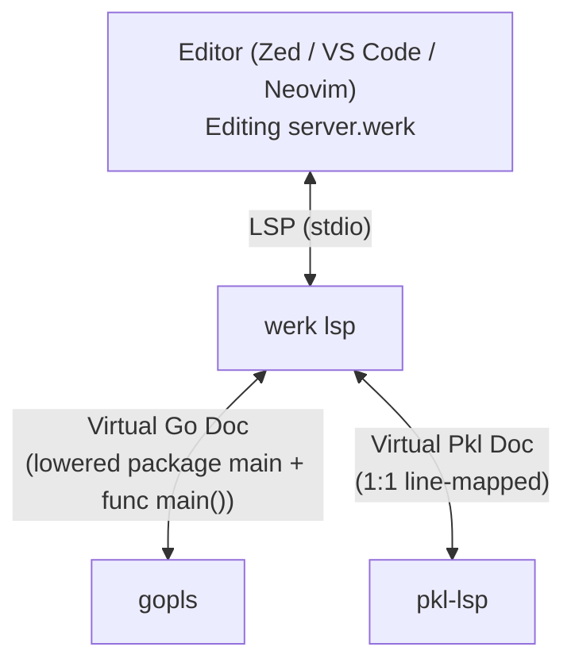

# 004 — Editor Tooling: Highlighting, Hybrid LSP & Zed Extension

## Overview

Tooling covers two distinct editing contexts:
1. **Editing `.werk` scripts:** Needs **top-level Go** syntax highlighting + `gopls` intelligence outside `config {}` (supporting top-level statements without `package main` or `func main()`), and **Pkl** syntax highlighting + `pkl-lsp` intelligence inside `config {}`.
2. **Editing `.pkl` files that `amends "werk:/..."`:** Handled natively by standard Pkl editor plugins (`pkl-lsp` + `tree-sitter-pkl`) via the `werk pkl-reader` external module reader described in [003_pkl_amends.md](003_pkl_amends.md).

---

## 1. Dual Syntax Highlighting (`tree-sitter-werklang` + Pkl Injection)

Standard `tree-sitter-go` only allows declarations (`package`, `import`, `func`, `type`, `const`, `var`) at `source_file` root—meaning raw top-level statements like `x := 10` or `fmt.Println(...)` would produce `ERROR` nodes if injected verbatim into unmodified `tree-sitter-go`.

Instead of maintaining a forked Go parser by hand, `tree-sitter-werklang` uses Tree-sitter's native **grammar inheritance (`grammar(GO, { ... })`)** over `tree-sitter-go`, adding only two things (~45 lines of `grammar.js`):
1. Allowing `$._statement` alongside `$._top_level_declaration` directly under `source_file` (with no `package_clause` required).
2. Adding `config_declaration` (`config [identifier] { pkl_body }`), whose `pkl_body` delegates to the native **Pkl** grammar via Tree-sitter language injection!

### `grammar.js` Sketch

```javascript
const GO = require("tree-sitter-go/grammar");

module.exports = grammar(GO, {
  name: "werklang",

  rules: {
    source_file: $ => seq(
      optional($.shebang),
      repeat(seq(
        choice(
          $.config_declaration,
          $._top_level_declaration,
          $._statement,
        ),
        optional($._terminator),
      )),
    ),

    shebang: _ => token(seq("#!", /.*/)),

    config_declaration: $ => seq(
      "config",
      optional(field("name", $.identifier)),
      "{",
      optional($.pkl_body),
      "}",
    ),

    // Balanced brace scanner respecting Pkl strings & nested block comments
    pkl_body: $ => repeat1($._pkl_chunk),
  },
});
```

### `queries/highlights.scm` & `queries/injections.scm`

- **`highlights.scm`:** Inherits `tree-sitter-go`'s highlight queries directly (so every Go statement, `:=` binding, struct literal, function declaration, and type highlights identically to `.go` files) plus `"config" @keyword` and `(config_declaration name: (identifier) @variable)`.
- **`injections.scm`:**
  ```scheme
  ; Parse the interior of `config { ... }` using the native Pkl grammar
  ((pkl_body) @injection.content
    (#set! injection.language "pkl"))
  ```

---

## 2. `werk lsp` — Virtual Document Multiplexing Proxy

`werk lsp` acts as an LSP multiplexer (following the architecture of `templ lsp` and Vue's Volar), sitting between the editor and two child language servers: **`gopls`** and **`pkl-lsp`**.



### Virtual Document Projections

For every open `<dir>/<name>.werk` buffer, `werk lsp` maintains two live in-memory projections synchronized on `textDocument/didOpen` and `textDocument/didChange`:

1. **Pkl Projection (sent to `pkl-lsp`):**
   - Uses the exact 1:1 line-preserving projection from [003_pkl_amends.md](003_pkl_amends.md) (everything outside `config { ... }` replaced by spaces with `\n` preserved).
   - **Zero coordinate math:** `(line, character)` positions inside `config { ... }` are identical between `<name>.werk` and the virtual Pkl document.

2. **Go Projection (sent to `gopls`):**
   - Lowers the `.werk` script using the same rules as `werk build` ([002_syntax_and_codegen.md](002_syntax_and_codegen.md)):
     1. Synthesizes `package main` and hoisted `import` declarations.
     2. Emits the generated `config` structs and `var <id> <id>Config`.
     3. Hoists top-level `type`, `const`, `func`, and captured global `var` / `:=` declarations to package scope.
     4. Wraps top-level executable statements in `func main() { ... }` (keeping original column 0 offsets so character columns match 1:1!).
   - Maintains a **bidirectional span map (`WerkSpan <-> VirtualGoSpan`)** recording each hoisted declaration and statement block's source line range in `<name>.werk` vs. its lowered line range in the virtual `.go` document.
   - **Standalone single-file script support (no `go.mod`):** If the open `.werk` file is outside any `go.mod` tree (e.g., `~/bin/deploy` or `/tmp/task.werk`), `werk lsp` binds `gopls` to that script's cached synthetic workspace (`$XDG_CACHE_HOME/werk/workspaces/<hash>/`), giving standalone single-file scripts the exact same `gopls` completions, hover, and type checking as full Go modules.
   - **Diagnostic filtering:** Suppresses synthetic artifacts (e.g., if `werk` injects `package main`) and surfaces genuine `werk` script errors directly (such as disallowing user-written `package ...` or `func main()`).
   - **Resilience while editing `config {}`:** When the user is mid-keystroke inside `config {}` and the Pkl block has a temporary syntax error, `werk lsp` retains the **last-known-good Go struct schema** so `gopls` completions and type-checking in the Go script body never flicker or break.

### LSP Feature Routing Table

| LSP Method | Cursor in Go Script Region | Cursor in `config {}` Region |
| :--- | :--- | :--- |
| `textDocument/completion` | Forward to `gopls` (span-mapped pos) | Forward to `pkl-lsp` (1:1 pos) |
| `textDocument/hover` | Forward to `gopls` (span-mapped pos) | Forward to `pkl-lsp` (1:1 pos) |
| `textDocument/definition` | Forward to `gopls` (if target is generated config field, jump to property in `config {}`; else inverse-map span) | Forward to `pkl-lsp` |
| `textDocument/signatureHelp` | Forward to `gopls` (span-mapped pos) | Forward to `pkl-lsp` (1:1 pos) |
| `textDocument/publishDiagnostics` | **Merged:** `werk` script checks + `gopls` diagnostics (inverse-mapped to `.werk` spans) + `pkl-lsp` diagnostics (inside `config {}`) | *(Same merged stream)* |
| `textDocument/formatting` | Format top-level Go decls & unindented `main` stmts via `gofmt`, format `config {}` body via Pkl formatter, stitch cleanly | *(Same whole-document pipeline)* |

---

## 3. Zed Extension (`extensions/zed`)

The Zed extension (`extensions/zed`) integrates `.werk` files cleanly alongside Zed's existing Go and Pkl extensions:

- **`extension.toml`:**
  - Registers the `werklang` Tree-sitter grammar (`tree-sitter-werklang`, inheriting `tree-sitter-go` + `config_declaration`).
  - Registers the `werk-lsp` language server (`werk lsp`).
- **`languages/werklang/config.toml`:**
  - Associates `*.werk` files **and** first-line `#!/usr/bin/env werk` shebangs (`first_line_pattern = "^#!.*\\bwerk\\b"`, supporting extensionless executable scripts like `~/bin/deploy`) with the `Werklang` language.
  - Configures brackets, comments (`//`, `/* */`), and auto-indentation.
- **`languages/werklang/highlights.scm` & `injections.scm`:**
  - Applies `tree-sitter-go` highlights + `(shebang) @keyword.directive` + `config` keyword/identifier captures.
  - Injects `pkl` into `(pkl_body)` (leveraging Zed's installed `pkl` extension grammar).
- **Rust WASM shim (`src/lib.rs`):**
  - Resolves `werk` on `PATH` (or workspace `bin/werk`) and launches `werk lsp`.
